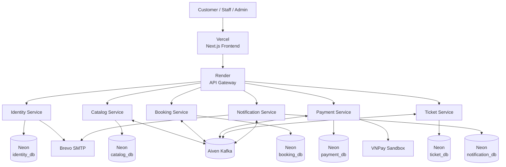
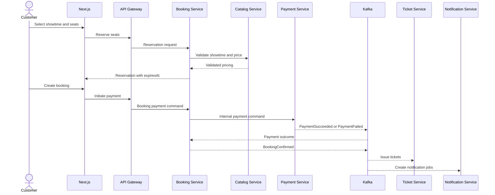

# Moonlight — Distributed Ticket Booking Platform

> A distributed transaction processing system designed around high-concurrency
> seat reservations, asynchronous payment workflows, and reliable fulfillment.

## Overview

Moonlight explores the design, implementation, deployment, and operation of a
transaction-heavy distributed system. The central problem is maintaining
correctness when many customers compete for the same inventory while booking,
payment, ticket issuance, and notification workflows cross independent service
and database boundaries.

The platform focuses on:

- Concurrent transaction processing for showtime seat inventory.
- Strong consistency within service-owned transactional data.
- Eventual consistency across booking, payment, ticket, and notification
  workflows.
- High-throughput asynchronous event processing with Kafka.
- Failure handling for provider timeouts, duplicate events, service restarts,
  and partial workflow completion.
- Performance evaluation through load, stress, spike, soak, and contention
  scenarios.
- Deployment and operational workflows for independently deployable services.

## Table of Contents

- [Moonlight — Distributed Ticket Booking Platform](#moonlight--distributed-ticket-booking-platform)
  - [Overview](#overview)
  - [Table of Contents](#table-of-contents)
  - [Key Features](#key-features)
    - [Customer Experience](#customer-experience)
    - [Cinema Operations](#cinema-operations)
    - [Transaction and Fulfillment Workflows](#transaction-and-fulfillment-workflows)
  - [System Architecture](#system-architecture)
    - [Architecture Overview](#architecture-overview)
    - [Service Responsibilities](#service-responsibilities)
    - [Communication Patterns](#communication-patterns)
    - [Data Ownership and Consistency](#data-ownership-and-consistency)
      - [Ownership](#ownership)
      - [Consistency model](#consistency-model)
  - [Core Booking Workflow](#core-booking-workflow)
  - [Core Technical Challenges](#core-technical-challenges)
    - [Concurrent Seat Reservation](#concurrent-seat-reservation)
    - [Distributed Booking and Payment](#distributed-booking-and-payment)
    - [Reliable Event Publication](#reliable-event-publication)
    - [Duplicate and Delayed Events](#duplicate-and-delayed-events)
    - [Provider Resilience](#provider-resilience)
    - [Ticket Issuance and Check-in Concurrency](#ticket-issuance-and-check-in-concurrency)
    - [Dead-Letter Handling and Replay](#dead-letter-handling-and-replay)
  - [Performance and Scalability](#performance-and-scalability)
    - [Scaling approach](#scaling-approach)
    - [Performance scenarios](#performance-scenarios)
  - [Reliability and Fault Tolerance](#reliability-and-fault-tolerance)
    - [Failure handling](#failure-handling)
    - [Recovery mechanisms](#recovery-mechanisms)
  - [Database Design](#database-design)
    - [Core Tables by Service](#core-tables-by-service)
    - [Database Design Decisions](#database-design-decisions)
  - [Technology Stack](#technology-stack)
  - [Testing and Quality](#testing-and-quality)
  - [Deployment and Operations](#deployment-and-operations)
    - [Cloud topology](#cloud-topology)
    - [Deployment workflow](#deployment-workflow)
    - [Operations](#operations)
  - [Getting Started](#getting-started)
    - [Prerequisites](#prerequisites)
    - [Local and external dependencies](#local-and-external-dependencies)
    - [Install and validate the backend](#install-and-validate-the-backend)
    - [Install and validate the frontend](#install-and-validate-the-frontend)
    - [Start local infrastructure](#start-local-infrastructure)
    - [Run the application services](#run-the-application-services)
  - [Project Structure](#project-structure)

## Key Features

### Customer Experience

- Account registration, email verification, authentication, and password reset.
- Movie, cinema, branch, and showtime discovery.
- Showtime-specific seat maps.
- Atomic multi-seat reservations with an authoritative expiration time.
- Booking creation and payment processing.
- Booking history and ticket access.

### Cinema Operations

- Branch-scoped staff authorization.
- Screen, seat layout, and showtime management.
- QR ticket validation and check-in.
- Manager and Platform Admin controls for sensitive operations.
- MFA protection for Platform Admin actions.

### Transaction and Fulfillment Workflows

- Booking-owned booking lifecycle and Saga orchestration.
- Payment-owned payment, provider callback, refund, and reconciliation state.
- Ticket-owned ticket issuance and check-in after booking confirmation.
- One ticket per booked seat.
- Notification jobs, retries, reminders, and dead-letter state.
- Cancellation and refund foundations integrated with the booking/payment
  workflow.

## System Architecture

### Architecture Overview

Moonlight uses independently deployable services organized around business
capabilities. Each service owns its data and migrations. The API Gateway is
the only public application API entry point; the frontend does not call
internal services directly.



### Service Responsibilities

| Service | Responsibility | Owned state |
|---|---|---|
| API Gateway | Routing, JWT validation, rate limiting, correlation propagation | None |
| Identity | Authentication, users, roles, branch permissions, MFA | `identity_db` |
| Catalog | Movies, cinemas, branches, screens, layouts, showtimes, pricing | `catalog_db` |
| Booking | Booking lifecycle, runtime inventory, reservations, and Saga orchestration | `booking_db` |
| Payment | Payment state, provider transactions, refunds, and reconciliation | `payment_db` |
| Ticket | Ticket issuance, QR validation, and check-in | `ticket_db` |
| Notification | Notification jobs, delivery attempts, retries, reminders | `notification_db` |

### Communication Patterns

| Interaction | Protocol | Reason |
|---|---|---|
| Frontend to Gateway | REST | Immediate user-facing request/response |
| Gateway to services | REST | Routing and synchronous commands/queries |
| Booking to Catalog | REST | Immediate showtime and pricing validation |
| Booking to Payment | Internal REST command | Start a payment operation |
| Domain integration | Kafka | Durable asynchronous event delivery |
| Payment provider integration | REST/webhook | Provider request and signed callback |
| Email delivery | SMTP | External email delivery |

### Data Ownership and Consistency

#### Ownership

| Business state | Source of truth | Local transaction boundary |
|---|---|---|
| Showtime definition and pricing | Catalog Service | Catalog database |
| Runtime seat availability | Booking Service | Booking database |
| Reservation and booking status | Booking Service | Booking database |
| Payment and refund status | Payment Service | Payment database |
| Ticket status and check-in | Ticket Service | Ticket database |
| Notification delivery status | Notification Service | Notification database |

#### Consistency model

| Workflow | Consistency model | Implementation |
|---|---|---|
| Seat reservation | Strong local consistency | Row locks, transaction, constraints |
| Payment state transition | Strong local consistency | Idempotency key and state machine |
| Booking/payment coordination | Eventual across services | Saga state and Kafka outcomes |
| Booking to ticket issuance | Eventual across services | `BookingConfirmed` event |
| Ticket check-in | Strong local consistency | Atomic `VALID -> USED` transition |
| Notification delivery | Eventual and retryable | Job state, lease, retry, dead-letter |

The system does not attempt to make all services strongly consistent in one
distributed transaction. Instead, it keeps invariants strong inside the
owning database and makes cross-service workflows explicit through events,
compensation, idempotency, and reconciliation.

Cross-service database access is not used. If a service needs another service's
state, it calls the owning service or consumes an approved domain event.

The ownership boundary is intentional: Booking decides whether a booking can
be confirmed, Payment records payment and refund outcomes, and Ticket issues
and validates tickets after `BookingConfirmed`. Payment success alone does not
change booking state, and Ticket does not become an owner of booking or
payment state.

## Core Booking Workflow



The primary failure branch is handled without a cross-service database
transaction:

```text
Payment succeeds
  -> Booking checks whether the reservation is still valid
  -> Confirm booking and publish BookingConfirmed

Payment succeeds after seats expire or are sold
  -> Do not issue tickets
  -> Start compensation and refund
  -> Reconcile refund completion
```

## Core Technical Challenges

### Concurrent Seat Reservation

**Problem**

Multiple customers may attempt to reserve the same showtime seat at the same
time. A multi-seat request must also avoid partially holding only some seats.

**Implementation**

- Booking stores runtime inventory per showtime.
- The reservation transaction locks the requested seat rows.
- All requested seats are validated before any hold is committed.
- The reservation is committed atomically or rolled back completely.
- A worker releases expired reservations using lease-safe state checks.
- Payment processing prevents the expiration worker from releasing seats too
  early.

**Protected invariant**

One seat has at most one active reservation, and a multi-seat reservation is
all-or-nothing.

### Distributed Booking and Payment

**Problem**

Booking and Payment own separate databases, but a successful payment must lead
to a valid booking while an invalid late payment must be compensated.

**Implementation**

- Booking owns the Saga state and orchestrates the workflow.
- Booking starts payment through an internal command.
- Payment publishes success/failure outcomes through Kafka.
- Booking confirms the reservation only after validating the payment outcome and
  seat state.
- Late success after seat release enters compensation and refund
  reconciliation.
- Persisted Saga state allows the workflow to resume after a service restart.
- A payment failure releases the reservation without issuing a ticket.

**Protected invariant**

Payment success alone never causes ticket issuance unless the Booking Service
confirms the booking.

### Reliable Event Publication

**Problem**

A service can commit a business transaction and then fail before publishing
the corresponding Kafka event.

**Implementation**

- Business state and the outgoing event are written in one local transaction.
- A service-owned Outbox publisher claims pending rows with a lease.
- Failed publications are retried.
- Expired leases are reclaimed after publisher failure.
- The original event ID is preserved across retries.
- A row becomes `PUBLISHED` only after Kafka accepts the event.
- Outbox tables are owned by the producing service and are not shared across
  service databases.

**Protected invariant**

A committed business transition does not silently lose its integration event.

### Duplicate and Delayed Events

**Problem**

Kafka delivery is at-least-once. A consumer may receive an event more than
once, or receive it after related business state has changed.

**Implementation**

- Events carry stable event IDs and correlation IDs.
- Consumers use event IDs, unique constraints, and state guards.
- Ticket issuance treats duplicate `BookingConfirmed` delivery as a no-op.
- Payment callbacks and refund operations use idempotency protections.
- Delayed payment outcomes are evaluated against current reservation state.
- Compensation handles a late payment success when the reservation is no
  longer valid.
- Refund reconciliation resolves outcomes that remain uncertain after a
  provider timeout.

**Protected invariant**

Retries and redelivery do not create duplicate tickets, refunds, or booking
state transitions.

### Provider Resilience

**Problem**

The payment provider can time out, become unavailable, or return retryable
failures during a transaction.

**Implementation**

- Provider requests use bounded timeouts.
- Only retryable failures are retried.
- The same operation identity is reused during retries.
- A Circuit Breaker opens after repeated provider failures.
- A cooldown period leads to a half-open probe.
- Successful probes close the circuit and allow normal traffic.
- Reconciliation handles outcomes that remain uncertain after timeout.

**Protected invariant**

Provider uncertainty does not become an incorrect success-shaped booking state
or an unbounded retry loop.

### Ticket Issuance and Check-in Concurrency

**Problem**

Booking confirmation can be delivered more than once, and two staff members
may scan one ticket concurrently.

**Implementation**

- Ticket Service consumes `BookingConfirmed`.
- Ticket issuance is unique per booking and seat.
- QR credentials are random/encrypted values and do not contain payment data.
- Check-in validates ticket, showtime, and branch scope.
- The database performs an atomic `VALID -> USED` transition.
- Only one concurrent scan can commit successfully.

**Protected invariant**

Each booked seat receives one ticket, and one ticket can be successfully used
only once.

### Dead-Letter Handling and Replay

**Problem**

A malformed or repeatedly failing event should not block an entire consumer
without leaving an operational recovery path.

**Implementation**

- Consumer failures are published to
  `<source-topic>.dlq.v1`.
- The versioned envelope stores source topic, partition, offset, event ID,
  correlation ID, failure metadata, and the original payload.
- Replay is an operator-only CLI, not a public API.
- Replay validates the source topic and contract.
- The DLQ offset is committed only after republishing succeeds.
- The original event identity is preserved so normal consumer idempotency still
  applies.

**Protected invariant**

Failed event processing is observable and recoverable without silently
acknowledging a message that was never handled.

## Performance and Scalability

### Scaling approach

- Stateless HTTP services can be scaled independently behind the Gateway.
- Kafka consumer groups distribute asynchronous processing.
- Outbox publishers and notification workers process independent jobs using
  database leases and `SKIP LOCKED`.
- Booking correctness remains in PostgreSQL rather than depending on an
  eventually consistent cache.
- Service-owned databases allow workload and connection-pool tuning per
  business capability.
- Correlation IDs and structured metrics support bottleneck investigation.

### Performance scenarios

The k6 harness includes:

| Scenario | Purpose |
|---|---|
| Baseline | Establish normal request behavior |
| Load | Observe behavior as concurrency increases |
| Stress | Identify saturation and failure points |
| Spike | Evaluate sudden traffic increases |
| Soak | Observe long-running stability |
| Mixed workload | Exercise representative customer traffic |
| Seat-map concurrency | Evaluate high-read concurrency |
| Seat contention | Evaluate many requests competing for one seat |

Correctness verifiers check booking contention, ticket uniqueness, and
check-in uniqueness alongside performance scenarios.

## Reliability and Fault Tolerance

### Failure handling

- Provider timeouts use bounded retry and Circuit Breaker behavior.
- Kafka consumers preserve correlation and event identity.
- Outbox failures remain retryable and lease-recoverable.
- Notification delivery retries with backoff and moves exhausted jobs to
  `DEAD_LETTER`.
- Consumer processing failures are routed to versioned Kafka DLQ topics.

### Recovery mechanisms

- Persisted Saga state allows Booking workflow resumption.
- Payment reconciliation handles uncertain provider outcomes.
- Outbox workers reclaim stale publisher leases.
- Kafka redelivery is safe because consumers are idempotent.
- Operator replay republishes recoverable DLQ events.
- Service readiness checks include required database and Kafka dependencies.

## Database Design

Moonlight uses PostgreSQL for transactional business data. A shared PostgreSQL
provider is compatible with the architecture only when each service still has
separate database ownership, credentials, migrations, and access boundaries.

| Database | Owner | Main responsibilities |
|---|---|---|
| `identity_db` | Identity Service | Users, roles, MFA, token lifecycle |
| `catalog_db` | Catalog Service | Movies, branches, screens, showtimes, pricing, catalog Outbox |
| `booking_db` | Booking Service | Runtime inventory, reservations, bookings, Saga, consumed events, Outbox |
| `payment_db` | Payment Service | Payments, provider transactions, webhooks, refunds, Outbox |
| `ticket_db` | Ticket Service | Tickets, consumed events, check-in, audit records, Outbox |
| `notification_db` | Notification Service | Jobs, delivery attempts, DLQ replay audit |

### Core Tables by Service

The README focuses on tables that define business correctness rather than
listing every authentication, audit, or delivery-support table.

| Service | Core tables | Why they matter |
|---|---|---|
| Catalog | `movies`, `screens`, `screen_seats`, `showtimes` | Authoritative showtime and seat-layout data used during validation |
| Booking | `showtime_seats`, `reservations`, `bookings`, `booking_sagas`, `booking_outbox_events` | Seat inventory, booking lifecycle, Saga state, and reliable booking events |
| Payment | `payments`, `payment_webhook_receipts`, `refunds`, `payment_outbox_events` | Provider state, idempotent callbacks, refunds, and payment events |
| Ticket | `tickets`, `ticket_check_ins`, `ticket_consumed_events` | Ticket uniqueness and one-time check-in state |
| Notification | `notification_jobs`, `notification_delivery_attempts` | Retryable notification delivery and failure state |

### Database Design Decisions

- **Row-level locking:** Booking locks the requested `showtime_seats` rows
  inside the reservation transaction. Concurrent requests for the same seat
  therefore serialize at the database boundary instead of relying on an
  eventually consistent cache.
- **Unique constraints:** Booking, Payment, and Ticket use uniqueness
  constraints together with state checks to make duplicate requests,
  callbacks, event delivery, ticket issuance, and check-in safe to retry.
- **Transaction boundaries:** Booking atomically validates and holds all
  requested seats, Payment atomically advances payment/refund state, and
  Ticket atomically performs the `VALID -> USED` check-in transition. The
  cross-service booking/payment workflow is eventual and is coordinated by
  Booking's Saga rather than a distributed database transaction.
- **Indexes:** Indexes support the hot paths and background work: lookup by
  showtime and seat, due reservations, provider operation identity, event
  identity, and retryable jobs. They reduce contention and full scans without
  moving correctness into a cache.
- **No cross-service foreign keys:** Each service owns its schema, migrations,
  and transaction boundary. Cross-service foreign keys would couple deployment
  and migration order, while direct joins would bypass service ownership.
  Services exchange stable identifiers through REST commands and Kafka events,
  then validate the referenced state through the owning service.
- **Outbox ownership:** Each producer writes its own Outbox row in the same
  local transaction as the business change. There is no shared Outbox table.

## Technology Stack

| Category | Technology | Role in the system |
|---|---|---|
| Frontend | Next.js, React, TypeScript | Customer, staff, and admin web application |
| Frontend forms | React Hook Form, Zod | Typed form state and boundary validation |
| Frontend data | TanStack Query | Gateway-backed server state |
| Backend | Node.js, NestJS, TypeScript | Independently deployable services |
| API | REST, API Gateway | Synchronous commands, queries, and routing |
| Database | PostgreSQL, Neon | Service-owned transactional data |
| Messaging | Apache Kafka, KafkaJS, Aiven | Durable asynchronous event processing |
| Reliability | Saga, Outbox, idempotency, Circuit Breaker | Distributed workflow correctness |
| Observability | Pino, Prometheus, Grafana, OpenTelemetry, Jaeger | Logs, metrics, and traces |
| Email | Brevo SMTP | Verification and notification delivery |
| Payment | VNPay sandbox | External payment processing |
| Performance | k6 and correctness verifiers | Load and contention evaluation |
| Local runtime | Docker Compose | Local PostgreSQL, Kafka, and observability |
| Delivery | GitHub Actions, Vercel, Render | CI/CD and cloud deployment |

## Testing and Quality

| Test type | Scope |
|---|---|
| Unit tests | Business rules, state transitions, parsers, provider resilience |
| Service tests | Repository transactions and service-owned behavior |
| API/Gateway tests | Routing, auth, correlation, response behavior |
| Integration tests | Explicitly isolated PostgreSQL and Kafka resources |
| Concurrency tests | Same-seat reservation and concurrent check-in |
| Failure tests | Timeout, retry, Circuit Breaker, duplicate delivery |
| Recovery tests | Outbox, Saga, consumer restart, reconciliation, DLQ replay |
| Performance tests | k6 baseline, load, stress, spike, soak, and contention |

The backend and frontend expose reproducible lint, type-check, build, and test
commands. Integration and performance scenarios use explicitly owned test
resources rather than application data.

## Deployment and Operations

### Cloud topology

```text
Vercel
  -> Render API Gateway
       -> Render Identity, Catalog, Booking, Payment, Ticket, Notification
       -> Neon PostgreSQL databases
       -> Aiven Kafka
       -> Brevo SMTP
       -> VNPay sandbox
```

Only the Gateway is exposed as the application API to the browser. Secrets are
provided through deployment platform configuration and are not committed.

### Deployment workflow

```text
Reviewed commit
  -> CI, build, and secret scan
  -> Build shared backend packages before each Render service
  -> Service-owned migration jobs
  -> Render/Vercel deployment hooks
  -> Health and readiness checks
  -> Smoke validation
```

Migrations run as dedicated jobs before service rollout, not as application
startup side effects. Migration jobs verify the target database identity and
use PostgreSQL advisory locks to serialize concurrent migration attempts.

### Operations

- `/health` reports process availability.
- `/ready` checks required database and Kafka dependencies.
- Structured logs include service and correlation context.
- Prometheus metrics expose request, workflow, retry, Outbox, and DLQ signals.
- OpenTelemetry can export traces to Jaeger or an OTLP-compatible collector.
- Graceful shutdown disconnects consumers and telemetry resources.

## Getting Started

### Prerequisites

- Node.js.
- pnpm.
- Docker Desktop with Docker Compose.
- k6 for performance scenarios, if running load tests.

### Local and external dependencies

The local Docker Compose stack runs only development infrastructure:

| Dependency | Local development | Deployed or external use |
|---|---|---|
| PostgreSQL | Docker Compose | Neon database credentials |
| Kafka | Docker Compose | Aiven Kafka credentials and TLS configuration |
| Prometheus, Grafana, Jaeger | Docker Compose | Deployment-specific observability configuration |
| Payment provider | Not provided by Docker Compose | VNPay sandbox credentials and callback configuration |
| Email provider | Not provided by Docker Compose | Brevo SMTP credentials |
| Vercel and Render | Not required locally | Used for frontend and backend deployment |

Docker Compose does not start the application services, create cloud
credentials, provide a payment sandbox, or deliver email through Brevo.
Backend and frontend processes are installed and run separately from the local
infrastructure.

### Install and validate the backend

```powershell
Set-Location backend
pnpm install
pnpm run ci
```

### Install and validate the frontend

```powershell
Set-Location frontend
pnpm install
pnpm run ci
```

### Start local infrastructure

```powershell
Set-Location infrastructure
Copy-Item .env.example .env
docker compose --env-file .env -f docker/compose.yml up -d
docker compose --env-file .env -f docker/compose.yml ps
```

Local infrastructure provides PostgreSQL, Kafka, Prometheus, Grafana, and
Jaeger only. Runtime service configuration is kept in ignored environment
files. To exercise payment callbacks or email delivery, configure the
corresponding VNPay sandbox or Brevo SMTP credentials in the service
environment; those integrations are not emulated by Compose.

### Run the application services

Docker Compose does not start the application services. After the local
infrastructure is healthy, create the ignored `.env` file for each backend
application from its `.env.example`, apply the service migrations, and build
the backend:

```powershell
Set-Location backend
pnpm --filter @ticket-booking/identity-service migrate
pnpm --filter @ticket-booking/catalog-service migrate
pnpm --filter @ticket-booking/booking-service migrate
pnpm --filter @ticket-booking/payment-service migrate
pnpm --filter @ticket-booking/ticket-service migrate
pnpm --filter @ticket-booking/notification-service migrate
pnpm run build
```

Run the Gateway and each required service from separate terminals:

```powershell
pnpm --filter @ticket-booking/api-gateway start
pnpm --filter @ticket-booking/identity-service start
pnpm --filter @ticket-booking/catalog-service start
pnpm --filter @ticket-booking/booking-service start
pnpm --filter @ticket-booking/payment-service start
pnpm --filter @ticket-booking/ticket-service start
pnpm --filter @ticket-booking/notification-service start
```

Run the frontend separately:

```powershell
Set-Location frontend
Copy-Item .env.example .env.local
pnpm run dev
```

For a deployed run, replace the local PostgreSQL and Kafka connection settings
with the managed Neon and Aiven configuration and provide VNPay and Brevo
credentials through the deployment platform. Vercel and Render are deployment
targets, not local prerequisites. Never commit credentials, provider secrets,
database files, or build output.

## Project Structure

```text
frontend/          Next.js web application
backend/
  apps/            API Gateway and six business services
  packages/        Shared configuration, observability, and recovery packages
  scripts/         Migration, validation, and operational scripts
infrastructure/    Local PostgreSQL, Kafka, and observability stack
performance/       k6 scenarios and correctness verifiers
docs/              Requirements, architecture, release, and deployment docs
.github/           CI/CD workflows and repository instructions
```
**